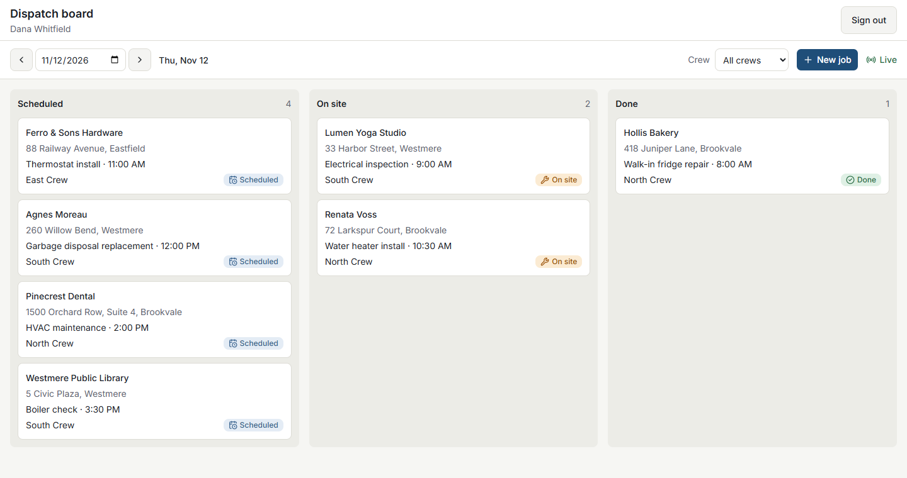
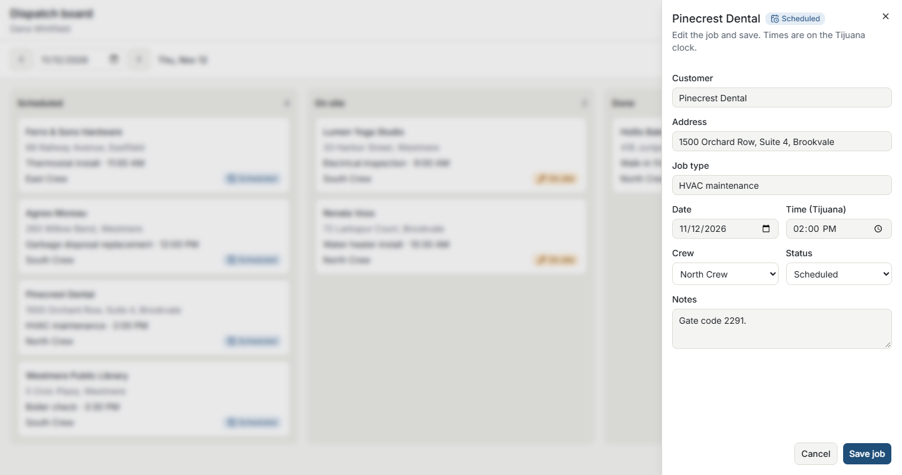
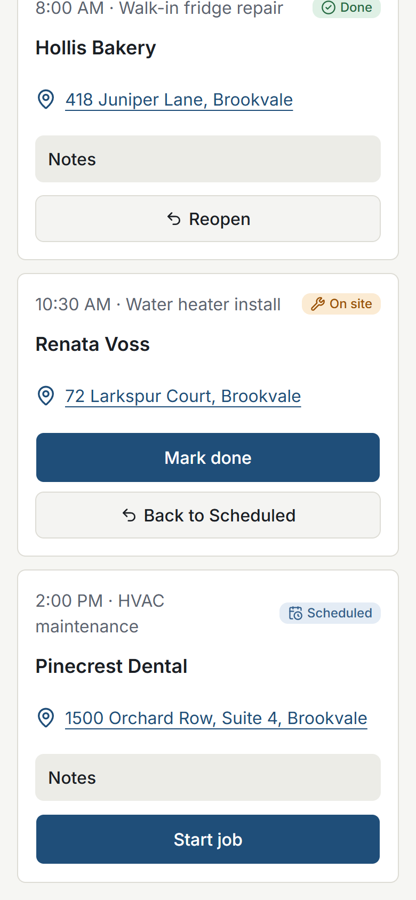
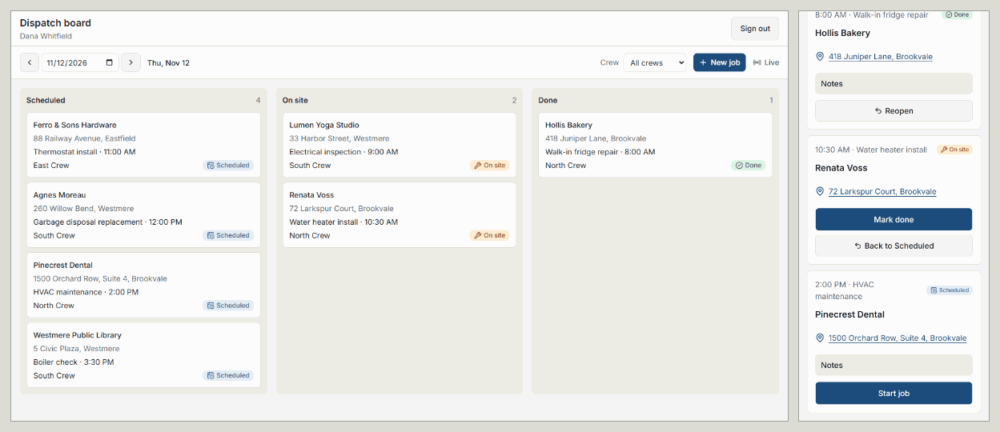

# Crew Dispatch Board

A live dispatch board for a fictional field-service company. The office schedules jobs and assigns crews, crews update job status from their phones, and the dispatcher sees every change without refreshing.

**Live:** https://crew-dispatcher-project.vercel.app

Next.js 16 (App Router) · TypeScript (strict) · Supabase (Postgres, Auth, Realtime) · Tailwind CSS + shadcn/ui · zod · Vitest · Vercel

All data is fictional. The live app has no public logins: the demo accounts can edit every job. Access is on request; the screens below show what it does.

## The three screens

### Dispatcher board (desktop)

Three columns by status, filtered by date and crew (including unassigned jobs). The top bar shows a **Live** indicator; when a crew taps a status on their phone, the card moves here within about a second.

### Job drawer (desktop)

Click a card to edit it in a side panel without leaving the board, or press **New job**. If a crew changes the job while it is open, the drawer says so and the save is refused instead of overwriting the crew's change.

### Crew day view (phone)

Only that crew's jobs for today. One large button per job (**Start job**, then **Mark done**), a smaller one to undo a mistaken tap, and the address opens in the phone's maps.

## Data model and access rules

| Table | Columns |
| --- | --- |
| `profiles` | id (auth user), name, role (`dispatcher` or `crew`), crew_id |
| `crews` | id, name |
| `jobs` | id, customer_name, address, job_type, scheduled_for (timestamptz), status (`scheduled`, `on_site`, `done`), crew_id (nullable), notes, updated_at |

Row-level security is on for every table. Nothing is readable without a login.

| Who | Can |
| --- | --- |
| Dispatcher | Read and write all jobs, crews and profiles |
| Crew | Read only its own crew's jobs. Change only status and notes, and only through the `update_job_status` function: one step at a time (forward or back), never another crew's job |
| Logged out | Nothing |

- A user cannot change their own role or crew (a trigger, for dispatchers too). New signups start as a crew member with no crew and see nothing.
- A job from another crew and a job that does not exist return the same "Job not found", so a crew cannot discover other crews' job ids.
- Realtime uses the same policies: a crew only hears about its own jobs, a logged-out visitor hears nothing.

Full rules: [`docs/spec.md`](docs/spec.md). Schema and policies: [`supabase/migrations/`](supabase/migrations/).

## Decisions and trade-offs

- **The URL is the state.** Date, crew filter and open job live in `?date=&crew=&job=`, validated with zod with safe fallbacks. Views can be shared and the back button works.
- **Live updates reload from the server.** A Realtime event triggers `router.refresh()` (one per burst, 300ms after the first event) instead of merging events in the browser: one source of truth, same filters, same access rules.
- **Saves cannot overwrite newer changes.** An edit only saves if `updated_at` still matches the version the dispatcher opened.
- **Crews never write to `jobs` directly.** A `security definer` function checks the crew and the status step, and touches no other column.
- **One business time zone.** "Today" means today in `America/Tijuana`, computed with `Intl` only. Daylight-saving changes are handled: a time that does not exist on a clock-change day is rejected with a clear message.
- **Postgres Changes, not Broadcast,** so Realtime reuses the tested RLS policies. Accepted limit: Postgres cannot check RLS on a deleted row, so logged-in users receive the id (only the id) of a deleted job. The app has no delete feature yet.
- **Validation at every boundary.** zod checks every form, hidden field and URL parameter, including the "return to this view" value after saving (no open redirects).
- **Tests run against the live Supabase project** with the public key and real demo logins, so they test the real policies. Each test sets up its own starting data, because the database is shared.
- **Public key format.** `NEXT_PUBLIC_SUPABASE_ANON_KEY` holds Supabase's new publishable key (`sb_publishable_…`), which replaces the old anon key. The service role key is not used anywhere.

## What I verified

Built with Claude Code, one small step at a time, with every plan and every database change approved first.

**Proved by tests (103, `npm test`).** RLS tests prove a crew cannot read or edit another crew's jobs, or change a job's customer, address or crew. Realtime tests prove a crew never hears about another crew's job. Each kind was made to fail once on purpose:

- A migration that widened the crew read policy made the 3 cross-crew read tests fail; the next migration restored it (both kept in `supabase/migrations/`).
- The Realtime tests failed before Realtime was turned on for `jobs`, and passed after.
- Removing one line from the refresh scheduler made 2 of its 5 tests fail.

**Checked on the live site.** Logged-out redirects, both roles, a phone tap updating the board, a crew blocked from the board, and only the public key in the browser code ([details](docs/spec.md#deployment)).

**Where the AI got it wrong.** From [`docs/ai-log.md`](docs/ai-log.md):

- **A dependency wrongly called suspicious (Step 1).** Claude flagged the `cn` package and proposed replacing it; reading the installed package showed it is shadcn's own. Kept as is.
- **Missing `connection()` (Step 4).** Claude called the login step verified after a build and scripted requests passed. In the browser, the console showed a prerender error: the session was read before telling Next.js the page depends on the request. Fixed in `lib/auth.ts`. Lesson: check in `next dev` with a real browser.
- **Wrong verification step (Step 5).** The checklist expected an empty message in each column for an empty day; the board shows one message for the whole day. Caught while checking in the browser; the checklist was corrected, not the code.
- **Tests that assumed the seed (Step 8a).** RLS undo tests failed after manual testing had moved a job's status. They now reset their own data before each test.
- **A flaky test explained too fast (Step 8a).** A Realtime test failure was blamed on the migration and called fixed after three passing runs. It failed again later; the real cause was a fixed 1s wait. It now waits until an event proves the connection works.

## What I'd build next

- Job timeline: who changed what and when (`job_events`, written by a trigger)
- A button that turns a crew's rough note into a clean job summary with the Claude API
- Adding a note from the phone (the database function already accepts one)
- Deleting jobs, together with a fix for the delete-event limit
- A daily reset of the demo data, so the live board always has jobs for today
- End-to-end browser tests for the two-window live update

## Run it locally

1. Create a Supabase project. Copy `.env.example` to `.env.local` and fill in the project URL and public key (Project Settings > API).
2. Apply the schema: `npx supabase link --project-ref <your-ref>`, then `npx supabase db push`.
3. In Authentication > Users, add `dispatcher@example.com`, `north.crew@example.com` and `south.crew@example.com` with "Auto Confirm User". Put their passwords in `.env.local` (`TEST_*_PASSWORD`, used by the tests only).
4. Run `supabase/seed.sql` in the SQL Editor. Re-run it any day to move the demo jobs to today.
5. `npm install`, then `npm run dev` (http://localhost:3000) and `npm test`.
